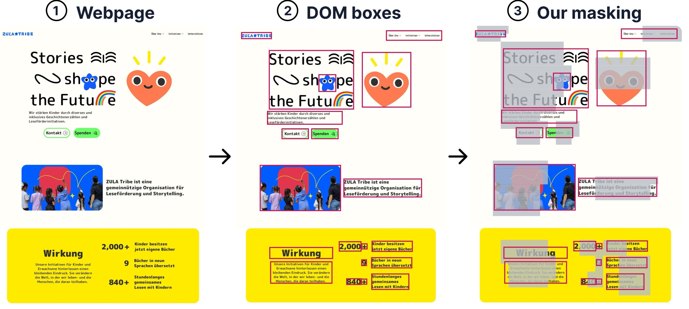
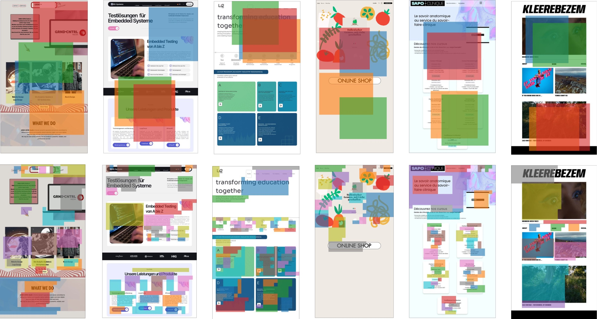
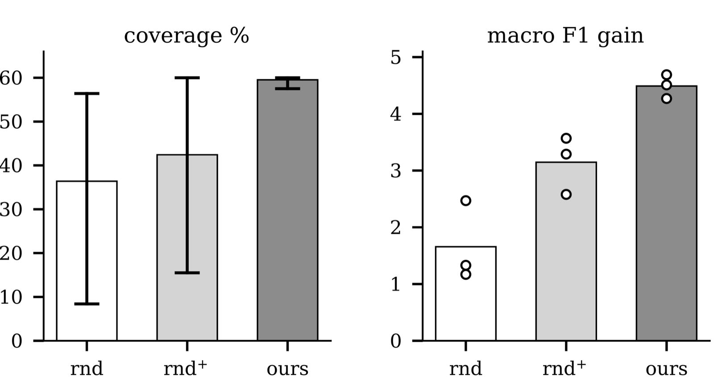
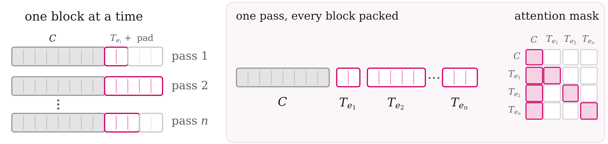
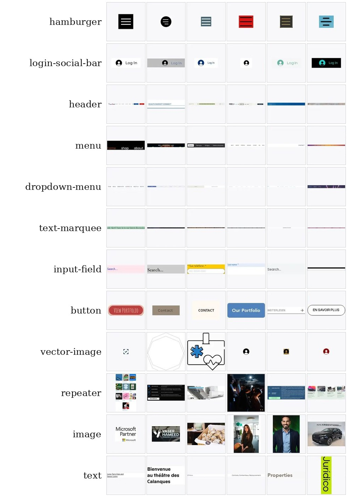

<h1 align="center">Masking by Design</h1>
<h3 align="center">Component-Conditioned Pretraining for User Interfaces</h3>

<p align="center">
  Shon Otmazgin<sup>*</sup>, Shahar Nahum<sup>*</sup>, Adi Dick-Charnilas, Gershon Goland, Amit Israeli, Gilad Barkan<br>
  Wix.com &nbsp;·&nbsp; <sup>*</sup>Equal contribution
</p>

<p align="center">
  
  <a href="https://huggingface.co/Wix/ui-encoder-ours"></a>
  <a href="https://huggingface.co/datasets/Wix/ui-components"></a>
  
</p>

<p align="center">
  
</p>
<p align="center"><sub>
<b>Component-conditioned masking</b>, on a real page from our corpus. <b>(1)</b> Webpage: the rendered screenshot, the only input the encoder receives.
<b>(2)</b> DOM boxes show where each component appears, taken from the page's structured document. <b>(3)</b> Our mask uses those boxes to place target patches.
Gray marks the targets. The visible patches provide the context for predicting them.
</sub></p>

A web page is built from components, and recovering them from pixels underlies
design tooling, accessibility, UI testing and software agents. Once rendered, a
page holds two representations: the screenshot an encoder sees, and the
structured document it was drawn from, which names every component and fixes
its box. Prior work has read that document as context, or predicted it back as
a target. We use it to **author the pretraining mask**. The sampler visits
components in the twelve target classes from smallest to largest and aims to
hide part of each while preserving visible context.

Our corpus is 136,277 rendered pages from Wix.com, a website-building platform
where a single vocabulary names every component. We continue pretraining a
**SigLIP2** encoder with **I-JEPA** under this policy, and measure it with a
linear probe that predicts each component's class: macro F1 rises from
**61.5 to 66.0**. To isolate the mask we pretrain again with random masking,
changing nothing else: the difference is **1.3 macro F1** across three seeds
(p = 0.045), and it is gained on the five classes a random draw under-covers,
where ours masks more than half of every class's area. Our mask improves all
twelve classes; the random draws leave some below the frozen SigLIP2 encoder.

This repository holds the evaluation code and the mask and predictor code. The
five pretrained encoders and 9,000 pages (the sealed test split and the split
the probe trains on, with every component's class and box) are on Hugging Face.

## Component-conditioned masking across pages

<p align="center">
  
</p>
<p align="center"><sub>
<b>The same six pages under both policies.</b> <i>Top</i>: random masking is blind to the page, so components go untouched on one page and vanish whole on the next.
<i>Bottom</i> shows blocks placed using the component boxes recorded in the page's document. Colors mark the target blocks to be predicted.
</sub></p>

## Results

<table>
<tr>
<td width="44%" valign="top">

<br><sub><b>Coverage and the macro F1 gain that follows it.</b> Coverage is the share of a class's patches the mask hides. Left: bars are the mean over the twelve classes, capped lines their full range. Right: the bar is the mean over three pretraining seeds, the dots those seeds. Coverage on the training pages, macro F1 on the test split.</sub>
</td>
<td width="56%" valign="top">

| class | SigLIP2 | random | random⁺ | **ours** |
|---|---:|---:|---:|---:|
| dropdown-menu | 53.2 | +10.9 | +11.3 | **+14.0** |
| menu | 65.6 | +4.8 | +6.9 | **+9.1** |
| header | 77.8 | +4.2 | +4.7 | **+7.5** |
| vector-image | 53.4 | +1.0 | +1.6 | **+3.3** |
| text | 82.7 | +2.1 | +2.9 | **+3.2** |
| button | 78.8 | 0.0 | +1.2 | **+2.1** |
| login-social-bar | 62.1 | −6.7 | −4.1 | **+2.0** |
| hamburger | 62.5 | −2.6 | −0.9 | **+1.1** |
| text-marquee | 35.4 | +3.9 | **+6.2** | +5.1 |
| repeater | 19.3 | +2.9 | **+3.4** | +2.5 |
| image | 71.1 | +1.7 | **+2.7** | +2.3 |
| input-field | 75.9 | −2.4 | **+2.0** | +1.7 |
| **macro F1** | **61.5** | +1.7 | +3.2 | **+4.5** |

<sub>Per-class F1 on the test split, linear probe, mean over three pretraining seeds (Table 2 of the paper). The SigLIP2 column is the frozen encoder's F1; each Δ is the change from it under continued pretraining with that mask. Bold marks the best mask per class. Ours masks at the band (0.5, 0.7), selected on the validation split. Seed standard deviation of macro F1: ours ±0.21, random⁺ ±0.51, random ±0.71; for the gain over random⁺, a paired t-test across the three seeds gives p = 0.045.</sub>

</td>
</tr>
</table>

**Where the gain comes from.** Coverage, the share of a class's patches the
mask hides, is what separates the policies. A random draw covers seven classes
at 44–56% and leaves five at 8–27%: hamburger, login-social-bar, header, menu
and dropdown-menu. Ours hides more than half of every class's patches. Measured
against random, random⁺ gains the same +1.5 on both groups; ours matches it on
the well-covered classes (+1.6) and gains +4.6 on the thinly covered ones,
which account for the whole 1.3-point lead over random⁺. Per class, the F1
gained follows the coverage added under ours (r = 0.72) and not under random⁺
(r = 0.05). It is not the amount masked: ours hides 34% of the page against
about 50% for a random draw, and raising ours to that budget, by widening the
band or adding blocks outside the components, moves validation macro F1 by at
most 0.6 (Table 4 of the paper).

**Class-balanced loss.** The thinly covered classes also put the fewest
patches into the loss, so we also balance the loss: every class's masked
patches carry the same total weight. Over random⁺, balancing alone gains +2.0
macro F1 and our mask +1.3, but on different classes: ours leads on the five
thinly covered (+3.2 against +1.8), balancing on the well covered (+2.1
against 0.0). Together they give the largest gain, +3.7 macro F1, best in nine
of the twelve classes (Table 5 of the paper).

## Released assets

| Encoder | Hugging Face | Seed-0 test macro F1 (%) |
|---|---|---:|
| SigLIP2 SO400M, frozen (starting point) | [`google/siglip2-so400m-patch16-naflex`](https://huggingface.co/google/siglip2-so400m-patch16-naflex) | — |
| random masking | [`Wix/ui-encoder-random`](https://huggingface.co/Wix/ui-encoder-random) | 62.66 |
| random⁺ masking | [`Wix/ui-encoder-random-plus`](https://huggingface.co/Wix/ui-encoder-random-plus) | 64.07 |
| random⁺, class-balanced loss | [`Wix/ui-encoder-random-plus-bal`](https://huggingface.co/Wix/ui-encoder-random-plus-bal) | 66.63 |
| **ours** (component-conditioned) | [`Wix/ui-encoder-ours`](https://huggingface.co/Wix/ui-encoder-ours) | **66.00** |
| ours, class-balanced loss | [`Wix/ui-encoder-ours-bal`](https://huggingface.co/Wix/ui-encoder-ours-bal) | 68.13 |

The seed-0 column gives the test macro F1 reported for each individual Wix
checkpoint in its model card. The paper reports averages over three
pretraining seeds. The frozen SigLIP2 baseline uses the original Google weights.

<details>
<summary><b>How the encoders were trained: every target block in one pass</b></summary>
<br>
<p align="center"></p>
<sub><i>Left</i>: one block at a time, as I-JEPA does. The context C is copied and re-encoded on every pass, and blocks are padded to the longest in the batch. <i>Middle, right</i>: all blocks are packed into one sequence, and an attention mask lets each target block see C and itself but never another block. C is encoded once, the padding goes, and cost follows the patch count rather than the block count. Code: <code>components_masking/training/jepa/predictor.py</code>.</sub>
<br><br>

Our mask gives one target block per component, fifteen on an average page and
forty on a busy one. Predicting them one at a time would copy the context forty
times, so the predictor reconstructs all of them in one pass, following
CrossMAE's cross-attention decoding. The context attends only within itself,
and each block attends to the context and to its own queries. A block is
predicted from the same context as before, and the predictor is the same in
every run, so the change cannot favour one mask over another.

| Setting | Value |
|---|---|
| Starting encoder | SigLIP2 SO400M, patch 16, NaFlex, ≤ 1,024 patches per page |
| Objective | I-JEPA latent prediction, smooth-L1 over the masked patches; target encoder a frozen copy of the starting weights |
| Predictor | 6-layer ViT, width 384, 6 heads, randomly initialized; the context encoder's learning rate is zero for the first 500 steps |
| Data | 118,583 training pages (the 125,277-page train split, keeping pages whose components cover ≥ 10% of the page), effective batch 64, 17,000 steps (≈ 9 epochs) |
| Optimizer | AdamW (β₁ = 0.9, β₂ = 0.999), weight decay 0.05, gradient clipping 1.0; cosine schedule, peak LR 5e-5 after a 1,000-step warm-up |
| random mask | 4 target blocks per page, each 15–20% of it, aspect ratio 0.75–1.5, as in I-JEPA; the whole page is kept as context |
| random⁺ mask | 16 target blocks per page, each 2–8% of it: a page carries 15.6 components on average, and 2–8% spans their typical sizes |
| Our mask | per component, a contiguous block along its longer axis, sized to a share drawn from (0.5, 0.7) of its patches; children are masked first and the parent's block goes around what they keep visible |
| Compute | about 4.4 hours per run on four L40S GPUs, no more than a random draw costs |

</details>

## Using an encoder

```python
from PIL import Image
from transformers import AutoImageProcessor, Siglip2VisionModel

repo = "Wix/ui-encoder-ours"
processor = AutoImageProcessor.from_pretrained(repo, use_fast=False)  # Pillow resizing, as in the evaluation
model = Siglip2VisionModel.from_pretrained(repo).eval()

inputs = processor(images=Image.open("page.png").convert("RGB"), return_tensors="pt")
patch_features = model(**inputs).last_hidden_state      # (1, 1024, 1152)
```

The encoder reads pixels only. Component boxes shaped the pretraining mask and
are not needed at inference.

## The data

<table>
<tr>
<td width="38%" valign="top"></td>
<td width="62%" valign="top">

9,000 rendered homepages with every component's class and box, in two splits:

| split | pages | components | role |
|---|---:|---:|---|
| `seed` | 4,000 | 62,837 | fits the probe and selects its regularization |
| `test` | 5,000 | 72,507 | held-out evaluation, read once |

```python
from datasets import load_dataset

ds = load_dataset("Wix/ui-components")
row = ds["seed"][0]
row["image"]        # PIL image of the page
row["classes"]      # ["header", "menu", ...]
row["rectangles"]   # [[x_min, y_min, x_max, y_max], ...]
```

Boxes are in image pixels with the origin at the top-left.

</td>
</tr>
</table>

Each page is one site's homepage, rendered in a headless browser 1,280 pixels
wide and cut at the section boundary closest to 2,160 pixels. Screenshot
heights therefore vary, and every recorded component appears in the
screenshot. A component is a page element that the platform stamps with its
own class token (`wixui-button`, `wixui-rich-text`, …). Seventeen tokens map to
the twelve classes; the other 168, mostly layout containers, are left
unlabelled.

| class | platform tokens |
|---|---|
| `text` | `rich-text`, `collapsible-text` |
| `image` | `image`, `video-box`, `video-player` |
| `menu` | `horizontal-menu`, `vertical-menu` |
| `input-field` | `text-input`, `search-bar` |
| `hamburger` | `hamburger-open-button` |

The other seven classes (`button`, `vector-image`, `header`, `repeater`,
`dropdown-menu`, `login-social-bar`, `text-marquee`) each come from the token
of the same name.

The 136,277 pages split into train (125,277), seed (4,000), validation (2,000)
and test (5,000), each page in exactly one. Seed and test are released.

The component counts above are those of the released rows, the set the probe
scores. Table S1 of the supplement counts components before export and lists 25
more (23 image, 1 text, 1 text-marquee): the export drops duplicate boxes and
boxes with no area inside the screenshot.

## Evaluating the released encoders

Requirements: Python 3.12 and a CUDA GPU (the reported runs used 4× NVIDIA
L40S). On a smaller GPU, lower `MODELS_PER_PASS` and `BATCH_SIZE` (environment
variables read by the script).

```bash
pip install -r requirements.txt
bash reproduce/reproduce.sh /path/to/workdir          # 4 GPUs: 0,1,2,3
MODELS_PER_PASS=1 BATCH_SIZE=8 WORKERS=8 \
  bash reproduce/reproduce.sh /path/to/workdir 0,0,0,0 # 1 GPU
```

`torch==2.11.0` from PyPI is built for CUDA 13. If `torch.cuda.is_available()`
is `False` on an older driver, install a CUDA 12 build instead, for example
`pip install 'torch==2.11.0+cu126' --index-url https://download.pytorch.org/whl/cu126`
(the `+cu126` suffix makes pip replace an installed PyPI build).
The probe explicitly uses the Pillow-backed SigLIP2 image processor and records its class in
`metrics.json`. Use a fresh work directory when changing datasets. Each work
directory records the Hub revision or local Parquet fingerprints it caches.

The script downloads the weights and evaluation dataset, runs the probe on
all six encoders, and prints per-class F1 and test macro F1 for the evaluated
checkpoints. The macro F1 table shows each Wix checkpoint's Hugging Face
seed-0 reference and the signed gap in F1 points. The paper reports averages
across three pretraining seeds.

Per-encoder outputs (report, `metrics.json`, per-component predictions) are
written to `<workdir>/out/<encoder>/`. To probe one encoder directly:

```bash
cd components_masking
python -m probes.probe --models ours=Wix/ui-encoder-ours --gpus 0,0,0,0 --root /path/to/workdir
```

### What is in the repository

`components_masking/` holds the evaluation code that produced the paper's
numbers, with clearer names and docstrings. Two files are adapted to read the
released dataset: `probes/probe_dataset.py` and `probes/probe.py`. It also
holds the pretraining mask samplers, cut down to the paper's settings, and the
packed predictor. The pretraining loop itself is not part of this release.

| File | Role |
|---|---|
| `probes/probe.py` | entry point: embed pages, fit the probe on `seed`, score `test` |
| `probes/embed.py` | page forward pass; component feature = mean of the patch features its box overlaps |
| `probes/probe_dataset.py` | reads the released dataset into per-split component tables; per-class training subsample |
| `probes/head.py` | linear probe with grouped-CV selection of `C` |
| `probes/scoring.py` | macro F1, balanced accuracy, per-class report |
| `training/jepa/masking.py` | pretraining mask samplers (random, random⁺, ours) and the box → patch mapping the probe shares |
| `training/jepa/model.py` | encoder wrapper (loads the released weights) |
| `training/jepa/predictor.py` | packed I-JEPA predictor: all target blocks of a page in one pass |
| `screenshots.py` | screenshot lookup used by `embed.py` |
| `reproduce/reproduce.sh` | runs `probes/probe.py` with the flags of the reported runs |
| `reproduce/show_results.py` | prints the output as the tables above |

### Protocol

- **Features.** Each page is encoded at a budget of at most 1,024 patches
  (SigLIP2 NaFlex, aspect-preserving), unmasked. A component's feature is the
  plain mean of every patch its box touches.
- **Probe.** `StandardScaler` → `LogisticRegression(lbfgs, class_weight="balanced")`.
  It is fitted on up to 1,000 components per class from `seed` (at most 5 per
  page for classes above the cap).
- **Regularization.** `C ∈ {1e-4, …, 10}` is selected by 3-fold cross-validation
  inside `seed`, grouped by page. Test data is never used for selection.
- **Score.** Macro F1 over the 12 classes on all 72,507 components of the
  5,000 `test` pages.

### Reproduction notes

- **Pass four GPU entries.** The training subsample is drawn from the order in
  which pages are embedded, and the probe shards pages across GPUs
  round-robin. The reported runs used four GPUs. Listing four entries, with
  repeats on smaller machines, gives the same order.
- **Page order.** Each released row becomes page `<split>-<row index>`. The
  rows are in the original page order, so the pages sort, shard and subsample
  as in the reported runs.
- **Numerics.** The CUDA encoder runs in FP16, and the probe averages patch
  features in FP32. The sharded path rounds the pooled component features to
  FP16 when writing temporary files, then loads them as FP32 for probe fitting.
  This matches the reported evaluation and also applies to `0,0,0,0` on a
  single physical GPU. Passing `--gpus 0` directly to the probe uses one process,
  keeps the pooled features in FP32, and changes the row order used for sampling.
  Scores can vary across hardware and software configurations.

## Limitations

- The mask and the evaluation use the same twelve classes, which cover 51% of
  the component instances a page carries. Everything outside them is treated
  as non-component area.
- At patch resolution, a component may contribute no target patches. For
  example, a one-patch component has no room for both a target and visible
  context. When the sampler finds no component target blocks on a page, it
  falls back to a random block.
- All pages come from one platform, and all runs use one backbone and one
  objective. With no downstream task or external dataset, whether the gain
  transfers beyond this probe is untested.
- Both baselines are random draws. The gain correlates with coverage, and
  masking non-component area adds nothing; other factors (blocks shaped to each
  component, never hiding a component whole) remain to be measured.

## Citation

Citation metadata will be added with the camera-ready version.

## License

The UI Encoder code is licensed under [Creative Commons
Attribution-NonCommercial 4.0 International](LICENSE). The Hugging Face
cards describe the terms for the dataset and checkpoints.
